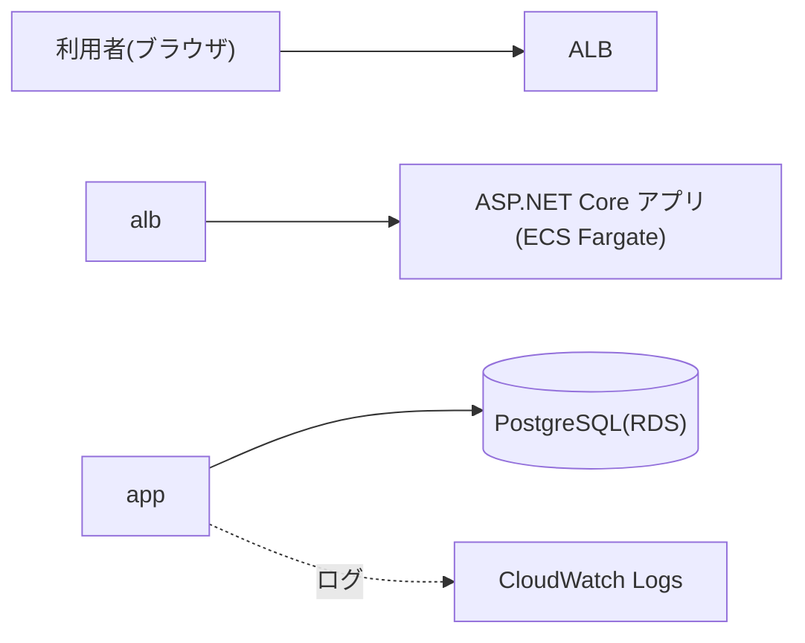
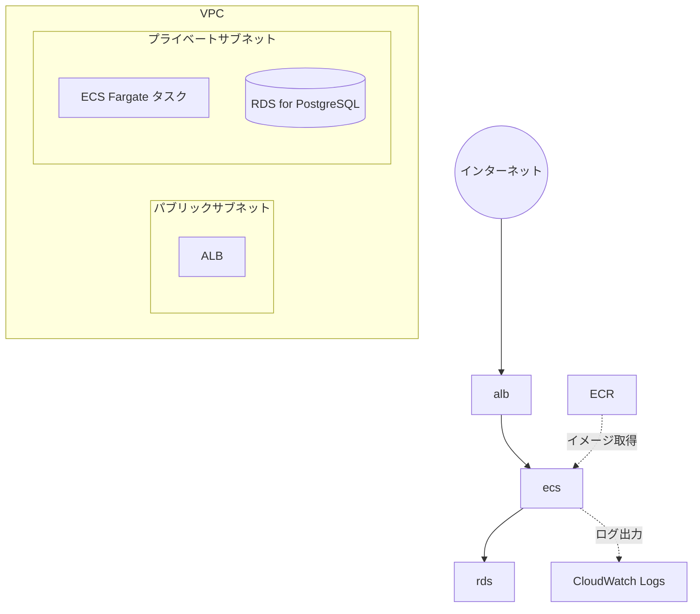
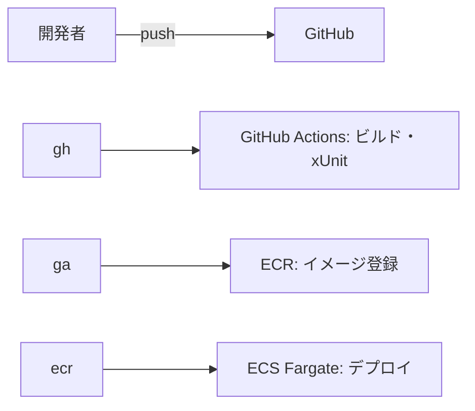

# システム概要・構成設計書

|項目|内容|
|-|-|
|システム名|AideaInventoryMng|
|版|初版(ドラフト)|
|作成日|2026-11-04|
|更新予定|実装結果を反映して更新予定|

※ 「(案)」「(未定)」と書かれた項目は、今後の作業で決定・更新します。

\---

## 1\. システム概要

### 1.1 目的

商品・倉庫/ロケーション別の在庫を、入庫・出庫・移動・棚卸の各処理を通じて正確に管理する在庫管理システムを開発する。

あわせて、ASP.NET Core、PostgreSQL、Docker、AWSを使ったWebシステムの設計・開発・デプロイ・検証までの一連の技術を習得することを目的とする。

### 1.2 スコープ

|区分|内容|
|-|-|
|対象|次章の機能一覧に記載した機能|
|対象外|認証・権限(Cognito等)。必要になった場合に追加を検討する|


\---

## 1\. 機能一覧

|No|機能|概要|実装予定|
|-|-|-|-|
|1|商品マスタ|商品の登録・参照・更新・削除||
|2|倉庫・ロケーションマスタ|倉庫と保管場所の登録・参照・更新・削除||
|3|入庫処理|入庫の登録と在庫の加算、履歴の記録||
|4|出庫処理|出庫の登録と在庫の減算、履歴の記録||
|5|在庫引当・マイナス在庫防止|出庫予定分の在庫確保、在庫がマイナスになる処理の拒否||
|6|排他制御・トランザクション管理|同時更新時の整合性の確保||
|7|在庫照会|商品・倉庫・ロケーション別の検索・集計||
|8|在庫移動|ロケーション間・倉庫間の在庫移動||
|9|棚卸|実在庫の入力と差異の調整||
|10|在庫下限アラート|下限を下回った商品の検出・通知||
|11|入出庫履歴|履歴の検索||
|12|CSV出力|履歴・在庫のCSV出力||
|13|管理画面(UI)|上記機能を操作する画面||
|14|入力チェック・例外処理|入力値の検証、エラー応答の統一||

\---

## 3\. 設計方針

|項目|方針|
|-|-|
|在庫の整合性|現在庫の更新と入出庫履歴の記録を同一トランザクションで行う。マイナス在庫は許可しない|
|排他制御|楽観的排他制御(同時実行トークンによる二重更新の検出)を採用する(案。PostgreSQLでの実装方式で検証)|
|入力チェック・例外処理|共通基盤(例外処理ミドルウェア、入力検証)に集約し、エラー応答の形式を統一する(案)|
|設定情報|接続文字列などの秘密情報はコードに埋め込まず、環境変数やAWSの機密情報管理機能から渡す(案)|
|設計書|docsフォルダにMarkdownで管理し、図はMermaidで記述する|

\---

## 4\. 使用技術

|分類|技術|
|-|-|
|言語|C#|
|フレームワーク|ASP.NET Core|
|ORM|Entity Framework Core|
|データベース|PostgreSQL|
|API仕様|OpenAPI|
|テスト|xUnit|
|コンテナ|Docker|
|ソース管理|Git / GitHub|
|CI/CD|GitHub Actions(案)|
|クラウド|AWS(VPC、IAM、ECR、ECS Fargate、ALB、RDS、CloudWatch)|
|UI|(未定。Razor PagesまたはBlazor Serverを候補とする。)|

\---

## 5\. システム構成

### 5.1 論理構成



### 5.2 アプリケーション構成

現在のプロジェクト構成は次のとおり。

```text
AideaInventoryMng
├── Program.cs
├── appsettings.json
├── Controllers
└── Data
    └── ApplicationDbContext.cs
```

今後の追加予定(案)。

|フォルダ・プロジェクト|役割|
|-|-|
|Entities|テーブルに対応するエンティティ|
|Services|入庫・出庫・引当・移動・棚卸などの業務ロジック。トランザクションの境界をここに置く|
|Dtos|API の入出力モデルと入力チェック|
|Middleware|例外処理の共通化|
|AideaInventoryMng.Tests|xUnitによる単体テスト(別プロジェクト)|

### 5.3 AWS構成(案)



|サービス|役割|
|-|-|
|VPC|アプリとDBを配置するネットワーク|
|ALB|インターネットからのリクエストをECSタスクへ振り分ける|
|ECS Fargate|Dockerコンテナ化したアプリの実行環境(サーバー管理が不要)|
|ECR|Dockerイメージの保管|
|RDS for PostgreSQL|データベース|
|IAM|タスクやCI/CDに付与する最小限の権限|
|CloudWatch|ログの確認、監視|

### 5.4 ネットワーク設計(案)

* ALBはパブリックサブネットに置く
* ECSタスクとRDSはプライベートサブネットに置き、RDSにはECSタスクのセキュリティグループからのみ接続を許可する
* ALBのセキュリティグループは、インターネットからの80/443のみを許可する

検討事項: プライベートサブネットのFargateタスクがECRやCloudWatchへ通信するには、NAT Gatewayか、VPCエンドポイントが必要になる。どちらも時間課金などの費用が発生するため、Day 6までに方式を決定する(未定)。

### 5.5 CI/CD(案)



* Day 6: ビルド・テストまでのCIを構築する
* Day 17: ECSへの自動デプロイを追加する

\---

## 6\. 非機能要件(案)

|項目|方針|
|-|-|
|整合性|第3章の方針に従う。同時更新のテストを行う(Day 10)|
|性能|在庫照会の検索条件にインデックスを設定し、実行計画を確認する(Day 17)|
|可用性・バックアップ|RDSの自動バックアップを有効にし、障害時の手順を整備する(Day 18)。Multi-AZ構成は費用との兼ね合いで検討する|
|セキュリティ|セキュリティグループとIAMは最小権限とする。DBは外部に公開しない。秘密情報はコードに含めない|
|運用・監視|CloudWatch Logsでアプリのログを確認する。メトリクスやアラームは必要に応じて追加する|
|コスト|AWS利用料金を調査し(Day 18)、検証後は不要なリソースを停止・削除する|

\---

## 7\. リポジトリ・ドキュメント構成

```text
AideaInventoryMng(リポジトリのルート)
├── AideaInventoryMng.slnx
├── AideaInventoryMng        (アプリ本体)
├── README.md
└── docs
    ├── 01_system-overview.md        システム概要・構成設計書(本書)
    ├── 02_database-design.md        データベース設計書
    ├── 03_api-design.md             API設計書
    ├── 04_processing-design.md      処理設計書
    ├── 05_docker-setup.md           Docker環境構築手順書
    ├── 06_aws-setup.md              AWS環境構築手順書
    ├── 07_test-spec-and-result.md   テスト仕様書・結果
    ├── 08_verification-report.md    動作検証報告書
    ├── 09_issues-and-solutions.md   問題点・解決方法の一覧
    └── 10_final-report.md           最終学習報告書
```

\---

## 8\. 未決事項

|項目|決定予定|備考|
|-|-|-|
|UI技術|Day 2|Razor Pages / Blazor Server など。簡易な構成にする|
|AWSリージョン|Day 6 まで||
|ネットワーク方式(NAT Gateway / VPCエンドポイント)|Day 6 まで|費用を比較して決定|
|Multi-AZ構成の要否|Day 6 まで|費用との兼ね合い|
|環境の分け方(ステージング/本番)|Day 6 まで|UATの実施環境に関係する|
|排他制御の実装方式|Day 10|PostgreSQLでの同時実行トークンの方式を検証|
|認証・権限|必要になった時点|現状は対象外|


