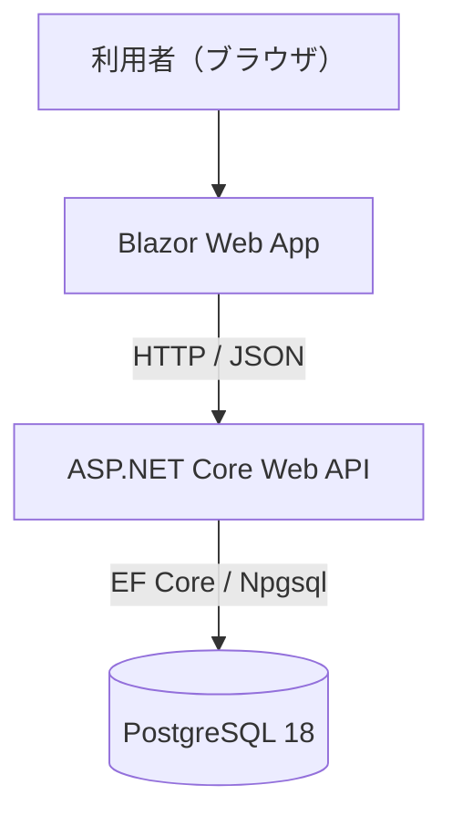
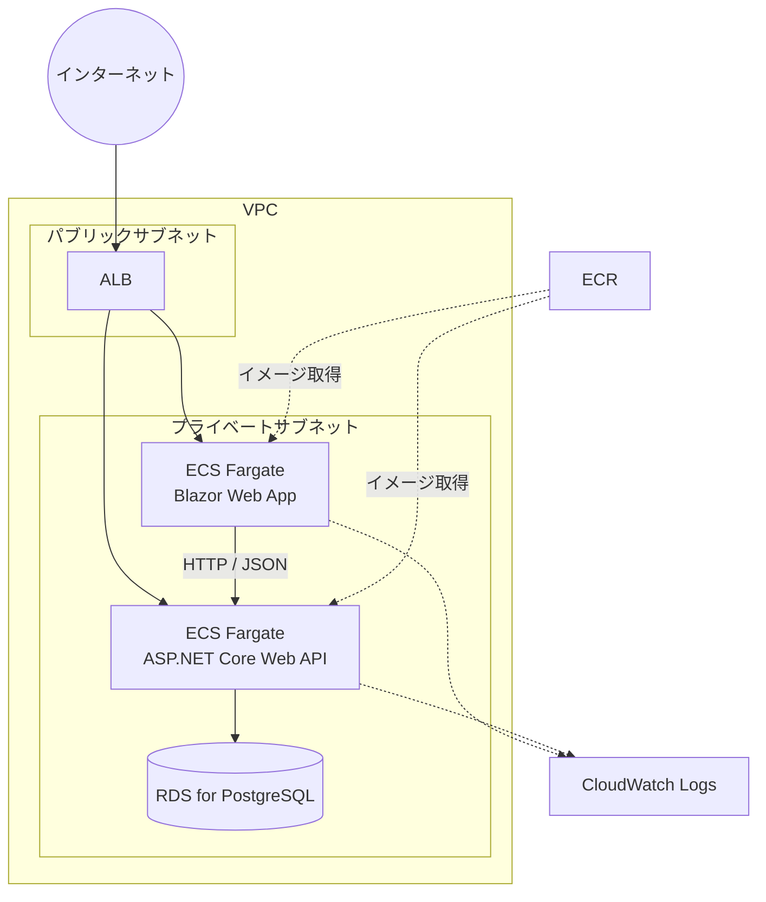
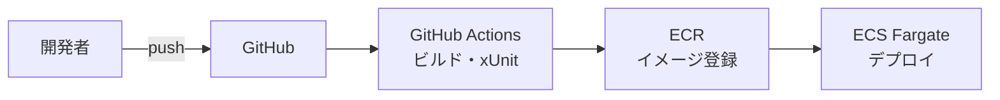

# システム概要・構成設計書

| 項目 | 内容 |
|---|---|
| システム名 | AideaInventoryMng |
| 版 | 第2版（ドラフト） |
| 作成日 | 2026-11-04 |
| 更新日 | 2026-11-17 |
| 更新内容 | UI技術をBlazor Web Appに決定。アプリケーション構成・システム構成を更新 |

※「案」「未定」と記載された項目は、今後の作業で決定・更新する。

---

## 1. システム概要

### 1.1 目的

商品・倉庫・ロケーション別の在庫を、入庫・出庫・移動・棚卸の各処理を通じて正確に管理する在庫管理システムを開発する。

あわせて、ASP.NET Core、Blazor、PostgreSQL、Docker、AWSを使ったWebシステムの設計・開発・デプロイ・検証までの一連の技術を習得することを目的とする。

### 1.2 スコープ

| 区分 | 内容 |
|---|---|
| 対象 | 次章の機能一覧に記載した機能 |
| 対象外 | 認証・権限（Cognito等）。必要になった場合に追加を検討する |

---

## 2. 機能一覧

| No | 機能 | 概要 | 実装予定 |
|---|---|---|---|
| 1 | 商品マスタ | 商品の登録・参照・更新・削除 | 実装済み（API） |
| 2 | 倉庫・ロケーションマスタ | 倉庫と保管場所の登録・参照・更新・削除 | 一部実装済み（API） |
| 3 | 入庫処理 | 入庫の登録と在庫の加算、履歴の記録 | 実装済み（API） |
| 4 | 出庫処理 | 出庫の登録と在庫の減算、履歴の記録 | 実装済み（API） |
| 5 | 在庫引当・マイナス在庫防止 | 出庫予定分の在庫確保、在庫がマイナスになる処理の拒否 | 実装済み（API） |
| 6 | 排他制御・トランザクション管理 | 同時更新時の整合性の確保 | 実装済み（API） |
| 7 | 在庫照会 | 商品・倉庫・ロケーション別の検索・集計 | 今後実装 |
| 8 | 在庫移動 | ロケーション間・倉庫間の在庫移動 | 今後実装 |
| 9 | 棚卸 | 実在庫の入力と差異の調整 | 実装済み（API） |
| 10 | 在庫下限アラート | 下限を下回った商品の検出・通知 | 今後実装 |
| 11 | 入出庫履歴 | 履歴の検索 | 今後実装 |
| 12 | CSV出力 | 履歴・在庫のCSV出力 | 今後実装 |
| 13 | 管理画面（UI） | 上記機能を操作する画面 | Blazor Web Appで実装中 |
| 14 | 入力チェック・例外処理 | 入力値の検証、エラー応答の統一 | 継続対応 |

※実装状況はAPI側を中心とした現時点の整理。画面側の実装状況とは区別する。

---

## 3. 設計方針

| 項目 | 方針 |
|---|---|
| 在庫の整合性 | 現在庫の更新と入出庫履歴の記録を同一トランザクションで行う。マイナス在庫は許可しない |
| 排他制御 | 楽観的排他制御（同時実行トークンによる二重更新の検出）を採用する |
| 入力チェック・例外処理 | 共通基盤（例外処理ミドルウェア、入力検証）に集約し、エラー応答の形式を統一する |
| 設定情報 | 接続文字列などの秘密情報はコードに埋め込まず、環境変数やAWSの機密情報管理機能から渡す |
| UIとAPIの分離 | Blazor Web AppとASP.NET Core Web APIを別プロジェクトとして構成する |
| API通信 | UIからAPIへHTTP通信を行い、JSON形式でデータを送受信する |
| 設計書 | docsフォルダにMarkdownで管理し、図はMermaidで記述する |

---

## 4. 使用技術

| 分類 | 技術 |
|---|---|
| 言語 | C# |
| UIフレームワーク | Blazor Web App |
| UI記述 | Razor / HTML / CSS |
| バックエンドフレームワーク | ASP.NET Core Web API |
| ORM | Entity Framework Core 10 |
| データベース | PostgreSQL 18 |
| DB接続プロバイダー | Npgsql |
| API仕様 | OpenAPI |
| API通信 | HTTP / JSON |
| テスト | xUnit |
| コンテナ | Docker |
| ソース管理 | Git / GitHub |
| CI/CD | GitHub Actions（案） |
| クラウド | AWS（VPC、IAM、ECR、ECS Fargate、ALB、RDS、CloudWatch） |

※Blazor Web Appの実行方式（Interactive Server / Interactive WebAssembly等）は今後決定する。

---

## 5. システム構成

### 5.1 論理構成

Blazor Web Appを画面側、ASP.NET Core Web APIをバックエンド側として分離する。



各構成要素の役割は以下のとおり。

| 構成要素 | 役割 |
|---|---|
| 利用者（ブラウザ） | システムの画面を表示し、利用者が操作する |
| Blazor Web App | 画面表示、入力、イベント処理、API呼び出し |
| ASP.NET Core Web API | 業務ロジック、入力検証、DBアクセス |
| PostgreSQL | 商品、倉庫、在庫、入出庫履歴などのデータ管理 |

Blazor Web Appからデータベースへ直接接続せず、必ずWeb APIを経由する。

### 5.2 アプリケーション構成

現在のバックエンドプロジェクトは次のとおり。

```text
AideaInventoryMng
├── Program.cs
├── appsettings.json
├── Controllers
└── Data
    └── ApplicationDbContext.cs
```

今後のソリューション構成（予定）。

```text
AideaInventoryMng
├── AideaInventoryMng.slnx
│
├── AideaInventoryMng.Web
│   ├── Program.cs
│   ├── Components
│   │   ├── Layout
│   │   └── Pages
│   ├── Services
│   └── wwwroot
│
├── AideaInventoryMng
│   ├── Program.cs
│   ├── Controllers
│   ├── Data
│   ├── Models
│   ├── Dtos
│   └── Services
│
├── AideaInventoryMng.Tests
│
├── README.md
└── docs
```

| プロジェクト・フォルダ | 役割 |
|---|---|
| AideaInventoryMng.Web | Blazor Web App。画面表示と利用者操作を担当 |
| Components | Razorコンポーネント、レイアウト、画面部品 |
| Pages | 商品一覧、在庫一覧、入出庫、棚卸などの画面 |
| Services（Web側） | Web APIへのHTTP通信を担当 |
| wwwroot | CSS、画像、JavaScriptなどの静的ファイル |
| AideaInventoryMng | ASP.NET Core Web API。業務処理とDBアクセスを担当 |
| Controllers | APIのエンドポイント |
| Data | DbContextなどDB関連 |
| Models | DBエンティティ |
| Dtos | APIの入出力モデル |
| Services（API側） | 入庫・出庫・引当・移動・棚卸などの業務ロジック |
| AideaInventoryMng.Tests | xUnitによるテスト |

※現在のAPIプロジェクトのフォルダ構成は、実装状況に応じて更新する。

### 5.3 AWS構成（案）

Blazor Web AppとWeb APIをそれぞれ独立したアプリケーションとして配置する構成を想定する。



| サービス | 役割 |
|---|---|
| VPC | アプリとDBを配置するネットワーク |
| ALB | インターネットからのリクエストを各ECSサービスへ振り分ける |
| ECS Fargate（Web） | Blazor Web Appの実行環境 |
| ECS Fargate（API） | ASP.NET Core Web APIの実行環境 |
| ECR | Dockerイメージの保管 |
| RDS for PostgreSQL | データベース |
| IAM | タスクやCI/CDに付与する最小限の権限 |
| CloudWatch | ログの確認、監視 |

※WebとAPIの配置方法、ALBのパスベースルーティング、ECSサービスの分離方法はAWS構築時に詳細を決定する。

### 5.4 ネットワーク設計（案）

- ALBはパブリックサブネットに配置する。
- ECSタスクとRDSはプライベートサブネットに配置する。
- RDSにはWeb API側のセキュリティグループからのみ接続を許可する。
- ALBのセキュリティグループは、インターネットからの80/443のみを許可する。
- Blazor Web AppからWeb APIへの通信は、設計した通信経路を通す。

検討事項：プライベートサブネットのFargateタスクがECRやCloudWatchへ通信するには、NAT GatewayまたはVPCエンドポイントが必要になる。どちらも費用が発生するため、AWS構築前に方式を決定する。

### 5.5 CI/CD（案）



- WebプロジェクトとAPIプロジェクトのビルド・テストを行う。
- Dockerイメージを作成し、ECRへ登録する。
- ECS Fargateへデプロイする。

---

## 6. 非機能要件（案）

| 項目 | 方針 |
|---|---|
| 整合性 | 第3章の方針に従う。同時更新のテストを行う |
| 性能 | 在庫照会の検索条件にインデックスを設定し、実行計画を確認する |
| 可用性・バックアップ | RDSの自動バックアップを有効にし、障害時の手順を整備する。Multi-AZ構成は費用との兼ね合いで検討する |
| セキュリティ | セキュリティグループとIAMは最小権限とする。DBは外部に公開しない。秘密情報はコードに含めない |
| 運用・監視 | CloudWatch Logsでアプリのログを確認する。メトリクスやアラームは必要に応じて追加する |
| コスト | AWS利用料金を調査し、検証後は不要なリソースを停止・削除する |

---

## 7. リポジトリ・ドキュメント構成

```text
AideaInventoryMng（リポジトリのルート）
├── AideaInventoryMng.slnx
├── AideaInventoryMng.Web
├── AideaInventoryMng
├── AideaInventoryMng.Tests
├── README.md
└── docs
    ├── 01_system-overview.md
    ├── 02_database-design.md
    ├── 03_api-design.md
    ├── 04_processing-design.md
    ├── 05_docker-setup.md
    ├── 06_aws-setup.md
    ├── 07_test-spec-and-result.md
    ├── 08_verification-report.md
    ├── 09_issues-and-solutions.md
    ├── 10_final-report.md
    └── 11_screen-design.md
```

| ファイル | 内容 |
|---|---|
| 01_system-overview.md | システム概要・構成設計書 |
| 02_database-design.md | データベース設計書 |
| 03_api-design.md | API設計書 |
| 04_processing-design.md | 処理設計書 |
| 05_docker-setup.md | Docker環境構築手順書 |
| 06_aws-setup.md | AWS環境構築手順書 |
| 07_test-spec-and-result.md | テスト仕様書・結果 |
| 08_verification-report.md | 動作検証報告書 |
| 09_issues-and-solutions.md | 問題点・解決方法の一覧 |
| 10_final-report.md | 最終学習報告書 |
| 11_screen-design.md | 画面一覧・画面遷移・画面項目設計 |

---

## 8. 未決事項

| 項目 | 決定予定 | 備考 |
|---|---|---|
| Blazorの実行方式 | GUI開発開始時 | Interactive Server / Interactive WebAssembly等を比較 |
| 画面構成・画面遷移 | GUI開発開始時 | 画面設計書で定義 |
| AWSリージョン | AWS構築前 | 利用料金・リージョンを比較 |
| ネットワーク方式（NAT Gateway / VPCエンドポイント） | AWS構築前 | 費用を比較して決定 |
| Multi-AZ構成の要否 | AWS構築前 | 費用との兼ね合い |
| 環境の分け方（開発・ステージング・本番） | AWS構築前 | UATの実施環境に関係する |
| 排他制御の実装方式 | 実装・検証時 | PostgreSQLでの同時実行制御を検証 |
| 認証・権限 | 必要になった時点 | 現状は対象外 |

---

以上