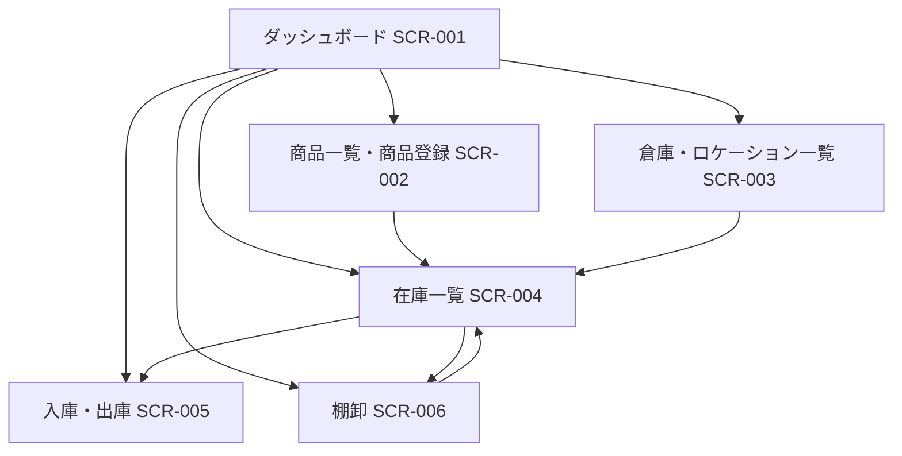

# 画面設計書

| 項目 | 内容 |
|---|---|
| システム名 | AideaInventoryMng |
| ドキュメント名 | 11_screen-design.md |
| 版 | 初版（ドラフト） |
| 作成日 | 2026-11-17 |
| 更新予定 | 画面・API実装に合わせて更新 |

## 1. 目的

本書では、AideaInventoryMng の画面構成、画面項目、操作内容、画面遷移および入力チェックについて定義する。

本システムは、商品・倉庫・ロケーション・在庫・入出庫・棚卸を管理する在庫管理システムである。

バックエンドは ASP.NET Core Web API、C#、EF Core、PostgreSQL を使用する。

※ フロントエンドの技術選定は今後決定する。

## 2. 画面一覧

| 画面ID | 画面名 | 主な機能 |
|---|---|---|
| SCR-001 | ダッシュボード | 在庫・入出庫・棚卸状況の確認 |
| SCR-002 | 商品一覧・商品登録 | 商品の検索・登録・編集・削除 |
| SCR-003 | 倉庫・ロケーション一覧 | 倉庫および保管場所の管理 |
| SCR-004 | 在庫一覧 | 商品・倉庫・ロケーション別の在庫確認 |
| SCR-005 | 入庫・出庫 | 入庫・出庫処理 |
| SCR-006 | 棚卸 | 棚卸開始・実棚数量入力・差異確認・確定 |

## 3. 共通画面仕様

### 3.1 共通レイアウト

基本的に以下の構成とする。

- ヘッダー：システム名、ログインユーザー情報
- サイドメニュー：各画面への移動
- メインエリア：画面タイトル、検索条件、一覧、入力フォーム
- メッセージエリア：処理結果・エラー表示

### 3.2 サイドメニュー

| メニュー | 遷移先 |
|---|---|
| ダッシュボード | SCR-001 |
| 商品管理 | SCR-002 |
| 倉庫・ロケーション管理 | SCR-003 |
| 在庫管理 | SCR-004 |
| 入庫・出庫 | SCR-005 |
| 棚卸管理 | SCR-006 |

### 3.3 共通ルール

| 項目 | 仕様 |
|---|---|
| 必須項目 | 必須入力項目は明示する |
| 数量 | 0以上の整数を基本とする |
| 日時 | DBはUTCで管理する |
| 削除 | 論理削除対象は削除日時を設定する |
| エラー | APIから返却されたエラーコード・メッセージを表示する |
| 登録・更新 | 処理成功後に一覧または詳細情報を再取得する |
| 二重送信 | 処理中はボタンを無効化する |

## 4. SCR-001 ダッシュボード

### 4.1 画面目的

システム全体の在庫状況や入出庫状況、棚卸状況を確認する。

### 4.2 表示項目

| 項目 | 内容 |
|---|---|
| 商品数 | 登録されている有効な商品数 |
| 倉庫数 | 登録されている有効な倉庫数 |
| 在庫総数量 | 全ロケーションの在庫数量合計 |
| 引当数量 | 引当済み数量の合計 |
| 利用可能数量 | 在庫数量－引当数量 |
| 本日の入庫件数 | 当日の入庫処理件数 |
| 本日の出庫件数 | 当日の出庫処理件数 |
| 棚卸状況 | 実施中の棚卸件数 |

### 4.3 表示内容

- 在庫状況のサマリー
- 最近の入庫履歴
- 最近の出庫履歴
- 実施中の棚卸一覧

### 4.4 操作

| 操作 | 内容 |
|---|---|
| 在庫一覧 | SCR-004へ遷移 |
| 入庫・出庫 | SCR-005へ遷移 |
| 棚卸管理 | SCR-006へ遷移 |
| 更新 | ダッシュボード情報を再取得 |

※ ダッシュボード用の集計APIは今後実装する。

## 5. SCR-002 商品一覧・商品登録

### 5.1 画面目的

商品情報の検索・登録・編集・削除を行う。

### 5.2 検索条件

| 項目 | 内容 |
|---|---|
| 商品コード | 商品コードによる検索 |
| 商品名 | 商品名による検索 |
| 有効・無効 | 商品の状態による絞り込み |

### 5.3 一覧表示項目

| 項目 | 内容 |
|---|---|
| 商品コード | product_code |
| 商品名 | name |
| 説明 | description |
| 単位 | unit |
| 単価 | price |
| 最低在庫数量 | min_stock_quantity |
| 登録日時 | created_at |
| 操作 | 詳細・編集・削除 |

### 5.4 登録・編集項目

| 項目 | 必須 | 内容 |
|---|---|---|
| 商品コード | ○ | 商品を識別するコード |
| 商品名 | ○ | 商品名称 |
| 説明 | - | 商品の説明 |
| 単位 | ○ | 個、箱、台など |
| 単価 | ○ | 商品単価 |
| 最低在庫数量 | ○ | 在庫不足を判断する基準 |

### 5.5 操作

- 新規登録
- 商品検索
- 商品詳細表示
- 商品編集
- 商品削除（論理削除）

### 5.6 入力チェック

- 商品コードは必須。
- 商品名は必須。
- 商品コードの重複を禁止する。
- 数量・単価は仕様で定めた範囲内とする。
- 削除済み商品は通常の一覧に表示しない。

## 6. SCR-003 倉庫・ロケーション一覧

### 6.1 画面目的

倉庫および倉庫内の保管場所（ロケーション）を管理する。

### 6.2 倉庫一覧

| 項目 | 内容 |
|---|---|
| 倉庫コード | warehouse_code |
| 倉庫名 | name |
| 住所 | address |
| 説明 | description |
| 登録日時 | created_at |
| 操作 | 詳細・編集・削除 |

### 6.3 倉庫登録・編集項目

| 項目 | 必須 | 内容 |
|---|---|---|
| 倉庫コード | ○ | 倉庫識別コード |
| 倉庫名 | ○ | 倉庫名称 |
| 住所 | - | 倉庫所在地 |
| 説明 | - | 倉庫に関する説明 |

### 6.4 ロケーション一覧

選択した倉庫に属するロケーションを表示する。

| 項目 | 内容 |
|---|---|
| ロケーションコード | location_code |
| ロケーション名 | 名称 |
| 倉庫 | 所属する倉庫 |
| 説明 | 保管場所の説明 |
| 操作 | 詳細・編集・削除 |

### 6.5 操作

- 倉庫の登録・編集・削除
- 倉庫の選択
- ロケーションの一覧表示
- ロケーションの登録・編集・削除

※ ロケーション管理APIの実装状況に合わせて詳細を確定する。

## 7. SCR-004 在庫一覧

### 7.1 画面目的

商品・倉庫・ロケーションごとの在庫状況を確認する。

### 7.2 検索条件

| 項目 | 内容 |
|---|---|
| 商品コード | 商品コードで検索 |
| 商品名 | 商品名で検索 |
| 倉庫 | 倉庫を選択 |
| ロケーション | ロケーションを選択 |
| 在庫不足 | 最低在庫数量を下回る商品を抽出 |

### 7.3 一覧表示項目

| 項目 | 内容 |
|---|---|
| 商品コード | product_code |
| 商品名 | 商品名称 |
| 倉庫コード | warehouse_code |
| ロケーションコード | location_code |
| 在庫数量 | quantity |
| 引当数量 | reserved_quantity |
| 利用可能数量 | available_quantity |
| バージョン | version |

### 7.4 在庫数量の計算

利用可能数量は次の計算式で求める。

利用可能数量 ＝ 在庫数量 − 引当数量

例：

| 項目 | 数量 |
|---|---:|
| 在庫数量 | 18 |
| 引当数量 | 7 |
| 利用可能数量 | 11 |

### 7.5 操作

- 在庫検索
- 在庫詳細表示
- 入庫画面への遷移
- 出庫画面への遷移
- 商品・倉庫別の在庫状況確認

## 8. SCR-005 入庫・出庫

### 8.1 画面目的

商品の入庫および出庫処理を行い、在庫数量と入出庫履歴を管理する。

### 8.2 入庫画面

#### 入力項目

| 項目 | 必須 | 内容 |
|---|---|---|
| 商品 | ○ | 入庫対象の商品 |
| 倉庫 | ○ | 入庫先の倉庫 |
| ロケーション | ○ | 入庫先の保管場所 |
| 入庫数量 | ○ | 入庫する数量 |
| 備考 | - | 入庫理由など |

#### 処理内容

1. 商品を選択する。
2. 倉庫を選択する。
3. ロケーションを選択する。
4. 入庫数量を入力する。
5. 入庫実行ボタンを押す。
6. APIで入力内容を検証する。
7. 在庫数量を加算する。
8. 入庫履歴（StockMovement）を登録する。
9. 処理結果を表示する。

### 8.3 出庫画面

#### 入力項目

| 項目 | 必須 | 内容 |
|---|---|---|
| 商品 | ○ | 出庫対象の商品 |
| 倉庫 | ○ | 出庫元の倉庫 |
| ロケーション | ○ | 出庫元の保管場所 |
| 現在庫数量 | 表示 | 現在の在庫数量 |
| 引当数量 | 表示 | 引当済み数量 |
| 利用可能数量 | 表示 | 出庫可能な数量 |
| 出庫数量 | ○ | 出庫する数量 |
| 備考 | - | 出庫理由など |

#### 処理内容

1. 商品を選択する。
2. 倉庫を選択する。
3. ロケーションを選択する。
4. 現在の在庫状況を表示する。
5. 出庫数量を入力する。
6. 出庫実行ボタンを押す。
7. APIで出庫可能数量を検証する。
8. 在庫数量を減算する。
9. 出庫履歴（StockMovement）を登録する。
10. 処理結果を表示する。

### 8.4 入出庫共通チェック

- 数量は1以上の整数とする。
- 出庫数量が利用可能数量を超える場合はエラーとする。
- 棚卸中のロケーションに対する入出庫は制限する。
- 在庫更新と入出庫履歴の登録は同一トランザクションで実行する。
- 処理に失敗した場合はロールバックする。

## 9. SCR-006 棚卸

### 9.1 画面目的

倉庫内の実在庫数量を確認し、システム上の在庫数量との差異を調整する。

### 9.2 棚卸一覧

| 項目 | 内容 |
|---|---|
| 棚卸ID | id |
| 倉庫 | warehouse_id |
| 棚卸日 | stocktake_date |
| ステータス | status |
| 登録日時 | created_at |
| 操作 | 詳細・開始・取消 |

### 9.3 棚卸登録項目

| 項目 | 必須 | 内容 |
|---|---|---|
| 倉庫 | ○ | 棚卸対象の倉庫 |
| 棚卸日 | ○ | 棚卸を実施する日 |

### 9.4 棚卸ステータス

| ステータス | 内容 |
|---|---|
| DRAFT | 棚卸開始前 |
| IN_PROGRESS | 棚卸実施中 |
| COMPLETED | 棚卸確定済み |
| CANCELLED | 棚卸取消済み |

### 9.5 棚卸詳細画面

棚卸開始時に対象在庫を取得し、棚卸明細（StocktakeLine）を自動生成する。

#### 明細表示項目

| 項目 | 内容 |
|---|---|
| 商品コード | product_code |
| 商品名 | 商品名称 |
| ロケーション | location_code |
| 理論在庫数量 | book_quantity |
| 実棚数量 | actual_quantity |
| 差異数量 | difference_quantity |

#### 差異数量の計算

差異数量 ＝ 実棚数量 − 理論在庫数量

例：

| 項目 | 数量 |
|---|---:|
| 理論在庫数量 | 18 |
| 実棚数量 | 16 |
| 差異数量 | -2 |

### 9.6 棚卸操作

| 操作 | 内容 | 実行可能な状態 |
|---|---|---|
| 棚卸登録 | 棚卸ヘッダーを作成 | - |
| 棚卸開始 | 対象在庫から明細を生成 | DRAFT |
| 実棚数量入力 | 実際の数量を入力 | IN_PROGRESS |
| 棚卸確定 | 差異を在庫に反映 | IN_PROGRESS |
| 棚卸取消 | 棚卸を取り消す | DRAFT / IN_PROGRESS |

### 9.7 棚卸確定処理

1. 実棚数量がすべて入力されていることを確認する。
2. 実棚数量と理論在庫数量の差異を確認する。
3. 差異数量を計算する。
4. 在庫数量を実棚数量に更新する。
5. 棚卸ステータスをCOMPLETEDに変更する。
6. 処理結果を表示する。

※ 棚卸確定時の在庫更新とステータス変更は、同一トランザクションで実行する。

### 9.8 棚卸入力チェック

- 実棚数量は0以上の整数とする。
- IN_PROGRESS以外の棚卸明細は更新できない。
- 棚卸確定時は実棚数量の未入力がないことを確認する。
- 確定後の棚卸データは変更できない。
- 棚卸中の対象ロケーションに対する入庫・出庫は制限する。

## 10. 画面遷移

## 11. APIとの対応

| 画面 | 主なAPI・機能 |
|---|---|
| SCR-001 | ダッシュボード集計API（今後実装） |
| SCR-002 | ProductsController |
| SCR-003 | WarehousesController、Locations関連API |
| SCR-004 | StocksController |
| SCR-005 | 入庫API、出庫API |
| SCR-006 | StocktakesController、StocktakeLines関連API |

※ APIのURL・HTTPメソッド・リクエスト／レスポンス仕様はAPI設計書と整合させる。

## 12. 今後の検討事項

| No. | 検討事項 | 内容 |
|---|---|---|
| 1 | フロントエンド技術 | MVC、Blazor、Reactなどから選定 |
| 2 | ログイン機能 | ユーザー認証・権限管理 |
| 3 | ダッシュボード | 集計対象・表示グラフの詳細 |
| 4 | 商品画像 | 商品画像の登録・表示 |
| 5 | 入出庫履歴 | 履歴検索・期間指定 |
| 6 | 棚卸 | 大量データの入力方法・一覧表示方法 |
| 7 | ページング | 一覧画面のページング・ソート |
| 8 | エラー表示 | APIエラーコードと画面メッセージの対応 |

---

以上。